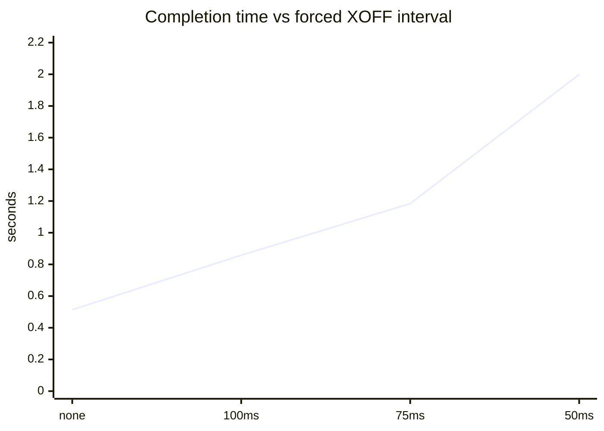

# KR260 verilog-ethernet + PAUSE two-port bridge example

[日本語版](README.ja.md)

This repository is an experimental source example that adds PAUSE handling to [verilog-ethernet](https://github.com/alexforencich/verilog-ethernet). The upstream PAUSE control RTL is integrated with the 1GbE MAC for use on the AMD Kria KR260 1GbE ports; the implementation has been verified on the target hardware image.

## Architecture

```text
J10A DP83867/RGMII
  -> verilog-ethernet MAC + PAUSE RX/TX
  -> J10A RX frame buffer (32 frames)
  -> J10B TX frame buffer (3 frames)
  -> verilog-ethernet MAC + PAUSE RX/TX
  -> J10B DP83867/RGMII
```

The reverse path from J10B to J10A has the same structure. Each RX frame buffer is directly connected through AXI4-Stream to the TX frame buffer of the opposite port, so packets entering one port are output from the opposite port.

## Contents

- `rtl/`: verilog-ethernet MAC/RGMII sources, RX/TX stores, watermark controller, PHY helper, and `static_dual_crossconnect.sv`.
- `rtl/standalone_pause_bridge_pl.sv`: PL port/interface contract. It instantiates the fixed cross-connect and delegates the validated MAC/store/CDC binding to the platform prerequisite modules `kr260_pause_bridge_platform` and `kr260_pause_bridge_endpoints`.
- `constraints/`: KR260 dual-RGMII constraints used by the validated variant.
- `sim/`: static cross-connect and datapath testbench sources.
- `host/`: corrected concurrent AF_PACKET forwarding test and measured benchmark record.
- `host/i350_swxoff/`: reference-only patch, build notes, source provenance, review, and sanitized hardware evidence for the temporary I350 XOFF driver. No kernel module binary is included.
- `tcl/`: the retained implementation constraint hook. The original production Tcl was intentionally not copied because it instantiates VNP4/PS/generated-IP infrastructure.

## Build boundary

This is source-only example material. A complete Vivado top still requires a board-specific PS/clock/MDIO wrapper and generated platform IP. Bitstream, XSA, BootFW, FIT, and DTB files are not included.

The added PL file is source-only and not hardware-qualified by itself. Its static elaboration requires the two documented platform modules, `axis_clock_converter`, AMD RGMII primitives, and XPM CDC definitions.

The `j10a_phy_mdio` and `j10b_phy_mdio` ports in the PL top are only an integration boundary. The shown assignments are not a completed bidirectional MDIO implementation; the platform wrapper must provide the actual I/O buffers, tri-state direction, and Clause-22 MDIO masters.

Use Vivado 2026.1, the KR260 carrier 2.0 pinout, and the verilog-ethernet source revision recorded in `DEPENDENCIES.md`. Do not infer that this directory alone is reproducibly buildable on an arbitrary KR260.

## Hardware assumptions

- KR260 carrier 2.0, J10A/J10B DP83867 PHYs, 1GbE RGMII.
- Existing PS clock/reset and MDIO initialization environment.
- J10B RX IDELAY 1000 ps timing-clean validated implementation; other PHY delay and clock-root values remain platform-specific.
- FPGA Manager runtime loading is handled by the existing platform; this example does not provide installation automation.

## Forwarding test

The test setup directly connects the KR260 J10A and J10B ports to the host Ubuntu PC's `j10a` and `j10b` network interfaces.

```text
sudo python3 host/runtime_forward.py j10a j10b --count 40000 --length 1500 --rcvbuf 16777216
```

The receiver runs concurrently with the sender and validates frame count, arrival order, and payload. The current lightweight script does not independently identify duplicate sequence numbers; its `duplicate` field remains zero and should not be interpreted as an independent duplicate audit. The requested receive buffer may be capped by host `net.core.rmem_max`.

## Measured PAUSE demonstration

The PAUSE behavior was tested using the I350 driver patched for the experiment under `host/i350_swxoff/`; see [host/i350_swxoff/README.md](host/i350_swxoff/README.md).

The following measurements show 40,000 1500-byte frames from J10A to J10B with I350 j10b software XOFF:

| XOFF interval | Completion time | Received | Missing | Payload mismatch |
|---|---:|---:|---:|---:|
| None   | 0.51398 s | 40,000 | 0 | 0 |
| 100 ms | 0.85802 s | 40,000 | 0 | 0 |
| 75 ms  | 1.18399 s | 40,000 | 0 | 0 |
| 50 ms  | 1.99899 s | 40,000 | 0 | 0 |

The host I350 NIC sends XOFF toward the directly connected KR260 J10B port at the specified interval. As the interval is shortened, XOFF is also sent from the KR260 J10A port to the other host I350 port. The resulting transfer time for 40,000 packets increases.

These are measurements of one validated hardware image, not a general performance guarantee, and are not a hardware-validation result for this published source-only top. The raw record and counter context are in `host/pause_completion_benchmark_20261012.md`.



## License and redistribution

The original RTL, Python, Tcl, Shell, and documentation authored for this example are released under the MIT License in [`LICENSE`](LICENSE), copyright Yutaka Yasuda. This repository is not uniformly MIT-licensed: verilog-ethernet-derived files retain their upstream MIT license and copyright notices; the I350 `igb` patches retain their original GPL-2.0-or-later/SPDX and copyright conditions; AMD generated IP and other third-party code retain their own terms and are not included. See `DEPENDENCIES.md` before redistribution.
